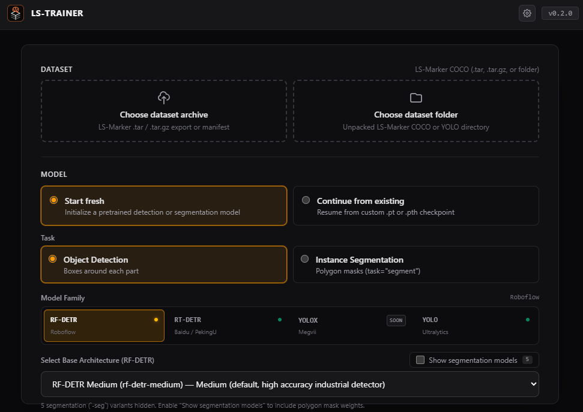
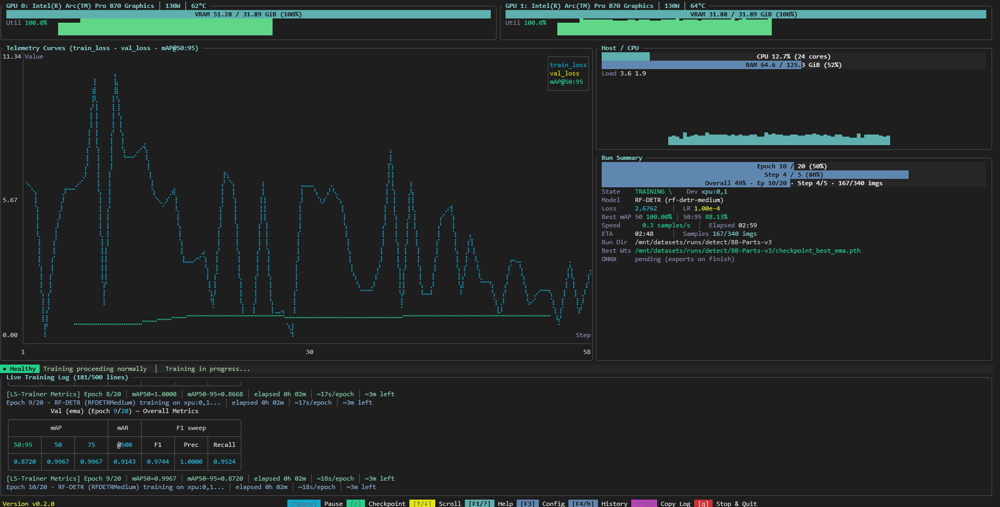
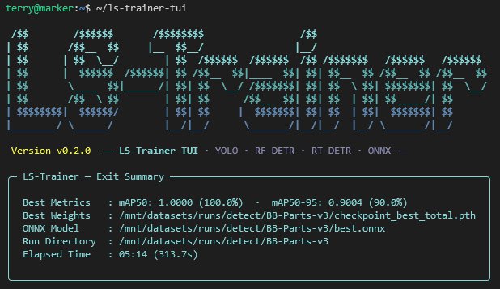

# LS-Trainer

Desktop app and terminal UI (`ls-trainer-tui`) for training YOLO, RF-DETR, and RT-DETR models on your own labeled datasets and exporting them to ONNX.

Built for the [LS-Marker](https://github.com/57471C/LS-Marker) &rarr; LS-Trainer &rarr; LS-Vision workflow. Point it at an LS-Marker (YOLO or COCO format) export, run a training job, and get a usable `.onnx` model without leaving the app.

## Screenshots

### Desktop App


### Terminal UI (`ls-trainer-tui`) — Live Training


### Terminal UI (`ls-trainer-tui`) — Exit Summary


## Features

- **Architectures**: Train **YOLO** (YOLO11 & YOLO26 detection and `-seg` instance segmentation), **RF-DETR** (detection & segmentation), and **RT-DETR** (`rtdetr-v2-r18`, `rtdetr-l.pt`, `rtdetr-x.pt`)
- **Segmentation weights**: `yolo11s-seg.pt`, `yolo11m-seg.pt`, `yolo26s-seg.pt`, plus `rf-detr-seg-*` (`task="segment"`)
- **Bench defaults** for a fixed top-down camera: `degrees` 180, `flipud` 0.5, `scale` 0.05, `close_mosaic` 10, `mosaic` 0
- **Image sizes**: `640`, `960` (default), and `1280` px
- **Dataset & GPU checks**: Warns when a segmentation run is pointed at plain bounding-box labels; supports single-GPU and multi-GPU Intel Arc XPU (`xpu:0,1`), NVIDIA CUDA, and CPU
- **Standalone TUI (`ls-trainer-tui`)**: Launch with no flags for an interactive Launch Menu matching the webview options, or pass CLI flags for headless/scripted launches with live GPU/CPU telemetry, loss/mAP curves, health status, `F1` help, `F3` config snapshot, and `F4` run history
- **TUI resume and datasets**: Resume from is optional. A `.pt` is YOLO `model=`; a `.pth` is RF-DETR / RT-DETR `pretrain_weights`. The suggested run name gains `-ft`. A dataset folder is used as it is. A `.tar`, `.tar.gz`, or `.tgz` with `data.yaml`, labels, and images unpacks into the dataset store. `F6` / Ctrl+O browses one folder at a time: folders are gold, `..` goes up, and Enter selects a matching file
- **ONNX Auto-export**: Exports the finished `best` weights to `best.onnx` at the selected image size (`dynamic=False`, `simplify=True`)
- **Run management**: Open the run folder or copy the weights and ONNX paths
- **Local Python sidecar**: Runs training and export from the project `.venv` (Ultralytics, `rfdetr`, `transformers`)

## Windows Installer & Post-Install Setup

The Windows NSIS installer configures the Python training environment automatically:
- **Automatic Setup Hook**: During installation, an NSIS hook automatically executes `setup-venv.bat` via `nsExec::ExecToLog` on the finish page, keeping all output visible in the installer log.
- **Dedicated Virtual Environment**: `setup-venv.bat` creates a `.venv` directory directly adjacent to the installed `app.exe` (using `%~dp0`), upgrades `pip`, and installs `ultralytics` and `rfdetr`. If a compatible system Python is not found on PATH, it prompts to download and install Python 3.12.
- **GPU Detection Priority (Intel Arc XPU &rarr; NVIDIA CUDA &rarr; CPU)**: Before installing ML packages, `setup-venv.bat` (and the in-app GPU check/repair) probes `Win32_VideoController` and `nvidia-smi`:
  1. **Intel Arc / XPU**: Installs the pinned Windows Intel Arc XPU PyTorch stack from `requirements-win-xpu.txt` (`https://download.pytorch.org/whl/xpu`) and avoids pulling CUDA packages. This is a deliberate temporary pin for Windows Arc stability because newer `+xpu` wheels regress with Ultralytics.
  2. **NVIDIA GPU**: Installs the matching CUDA 12.8 (`cu128`, Blackwell / RTX 50-series) or CUDA 12.4 (`cu124`) PyTorch build.
  3. **CPU Fallback**: Installs the lightweight CPU PyTorch wheel (`https://download.pytorch.org/whl/cpu`) when neither Intel Arc nor NVIDIA hardware is present.
- **Hardware Verification**: At the conclusion of setup, it verifies `torch.xpu.is_available()` and `torch.cuda.is_available()` and prints the active training accelerator. During RF-DETR training, `torch.xpu.is_available()` is preferred first (`xpu`), followed by `torch.cuda.is_available()` (`cuda`), with `cpu` as the final fallback.
- **Low-Friction**: No extra user steps are needed after clicking Finish—the application is ready to run immediately.

## Linux Setup (Linux Mint, Ubuntu, Debian)

For Linux systems (including single or multi-GPU Intel Arc Pro workstations):

```bash
chmod +x setup-linux.sh
./setup-linux.sh
```

The script automatically detects:
1. **Intel Arc / XPU GPUs** (via `lspci`, `xpu-smi`, and DRM sysfs), pulling the official PyTorch XPU build (`https://download.pytorch.org/whl/xpu`).
2. **NVIDIA GPUs** (via `nvidia-smi`), installing CUDA 12.8 or 12.4 builds.
3. **CPU Fallback** when no discrete GPU is found.

### Intel Arc Compute Prerequisites (Linux Mint / Ubuntu)
Before training on Intel Arc GPUs under Linux:
- Install compute runtime and Level Zero packages:
  ```bash
  sudo apt update && sudo apt install -y intel-opencl-icd intel-level-zero-gpu level-zero
  ```
- Ensure your user belongs to the `render` and `video` groups to access `/dev/dri/renderD*` devices:
  ```bash
  sudo usermod -aG render,video $USER
  ```
  *(Log out and log back in for group membership to take effect)*


## Stack

- Tauri 2
- Svelte + TypeScript + Vite
- Python sidecar (Ultralytics YOLO)

## Development

### Prerequisites

- Node.js
- Rust
- Python 3.10+ (with a virtual environment)

### Setup

```bash
npm install
```

#### Python environment

Python 3.10–3.12 is recommended.  
Python 3.13+ can work but may have slower wheel support for some Ultralytics dependencies.

```powershell
# Create the virtual environment in the project root
python -m venv .venv

# Activate it (Windows)
.\.venv\Scripts\Activate.ps1

# Upgrade pip (recommended)
python -m pip install --upgrade pip

# Install Ultralytics
pip install ultralytics
```

If you later add a `requirements.txt`, use:

```powershell
pip install -r requirements.txt
```

The app looks for this `.venv` when it runs training and ONNX export.

### Run

```bash
# Desktop app (Tauri + Svelte)
npm run tauri dev

# Standalone Terminal UI (no flags opens the interactive Launch Menu)
cargo run --manifest-path src-tauri/Cargo.toml --bin ls-trainer-tui
```

The app expects a YOLO-format dataset folder/archive (`.tar`, `.tar.gz`, `.tgz`, `.zip`) or a COCO export (for RF-DETR).  
Detection runs are written under `runs/detect`. Segmentation runs are written under `runs/segment`.  
When auto-export is on, a successful run writes `best.onnx` in the run directory. Copy that path for LS-Vision.

## Project status

Version 0.2.2. Supports local detection and instance-segmentation training (YOLO, RF-DETR, RT-DETR), standalone TUI with optional resume and folder browse, and ONNX export.
